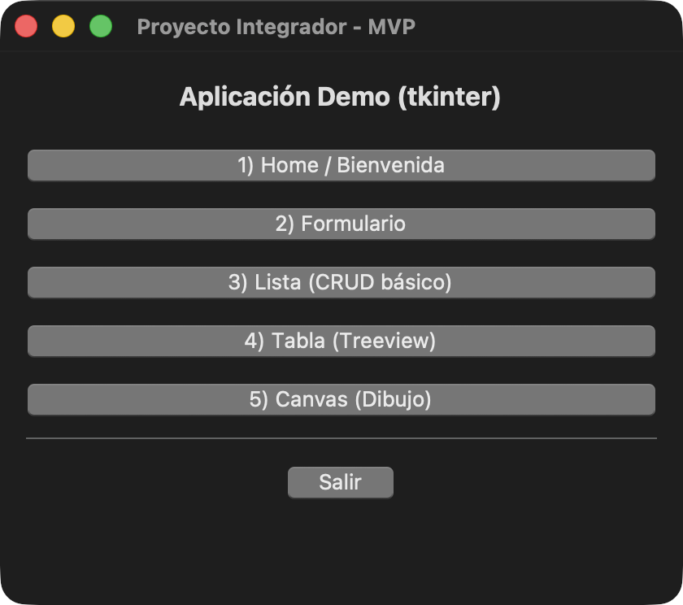

# Sesión 3 — Proyecto integrador con Tkinter

En esta sesión el proyecto consiste en una aplicación de Python con un menú principal que abre cinco ventanas. Cada ventana está en su propio archivo dentro de [`src/app/`](src/app).



## Qué hace cada ventana

1. **Bienvenida.** Muestra un aviso al presionar un botón.
2. **Formulario.** Pide el nombre y la edad, revisa los datos y permite guardarlos en un archivo de texto.
3. **Lista.** Permite agregar elementos, eliminar el seleccionado o limpiar la lista.
4. **Tabla.** Muestra los datos de [`sample.csv`](data/sample.csv).
5. **API y gráficas (Emiliano).** Consulta 48 horas de temperatura de León con Open-Meteo, muestra gráficas de línea, barras y dispersión, y permite guardar los datos en CSV.

En la [documentación de la sesión](docs/04_skeleton_5_ventanas_tkinter_equipo.md) están los pasos para abrir y revisar la app, las seis capturas y los roles del equipo.

## Sesión 7 — Versión de Emiliano

Abrir la carpeta en VS Code, seleccionar el Python de `.venv` e instalar las dependencias:

```bash
python -m pip install -r requirements.txt
```

Presionar **F5** con **Ejecutar main (src.app.main)**, abrir **5) API y gráficas (Emiliano)** y pulsar **Cargar y mostrar gráficas**. Desplazarse para ver las tres gráficas; **Guardar CSV** conserva la consulta. Se necesita internet para cargar datos nuevos.

También se puede ejecutar desde la raíz del proyecto con el entorno activo:

```bash
python -m src.app.main
```

En la [documentación de Emiliano](docs/05_adaptacion_ventana_emiliano.md#sesión-7--api-pública-persistencia-y-gráficas) están la variante, los cambios, las instrucciones completas, las capturas y la reflexión. Se incluye un [CSV de ejemplo con 48 registros](data/temperaturas_emiliano.csv).
