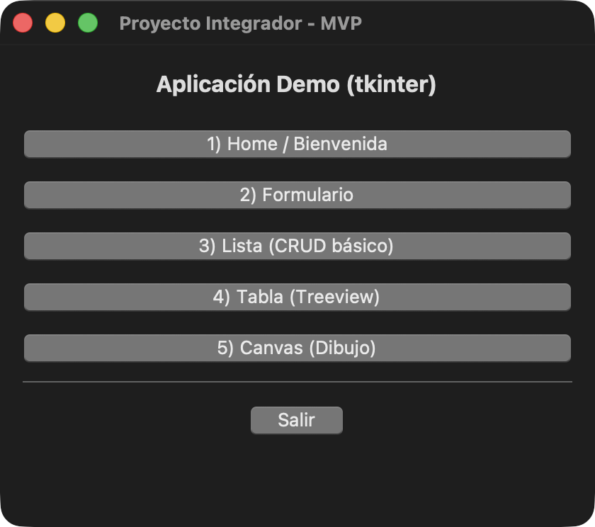
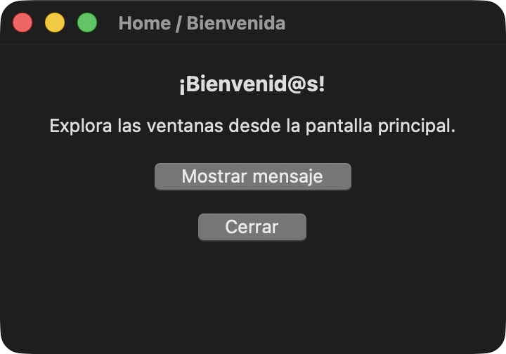
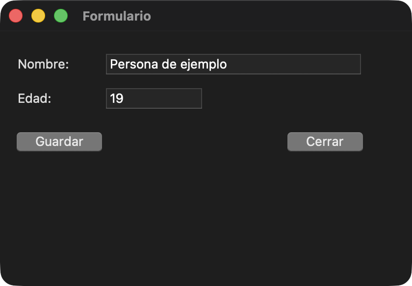
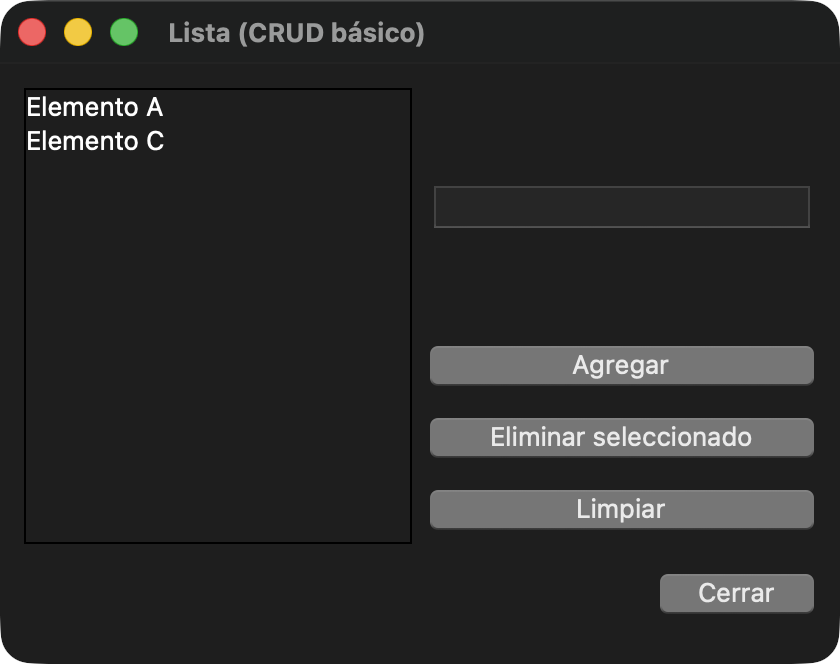
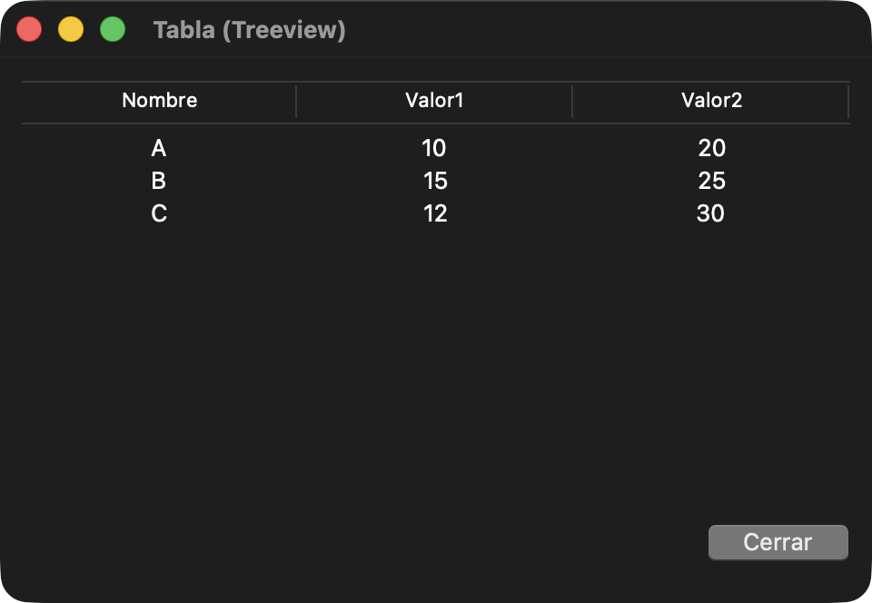
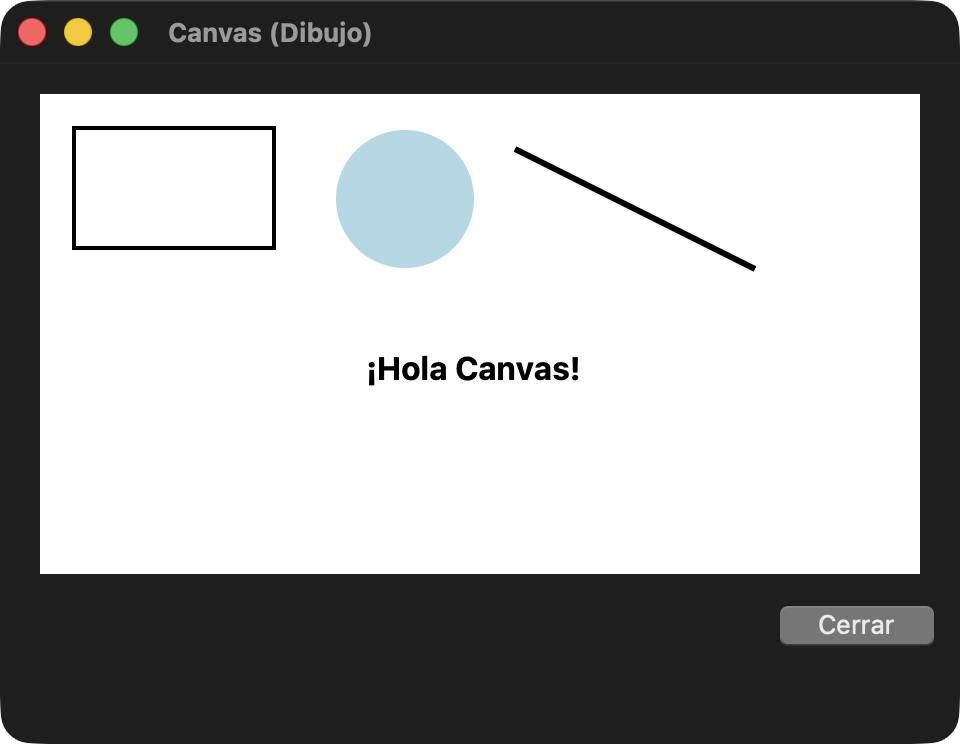

# Sesión 3. Ventana principal y cinco subventanas con Tkinter

## Qué hace la aplicación

La ventana principal tiene cinco botones de navegación. Cada botón llama a una función de su propio archivo y abre una subventana con `tk.Toplevel`. Las cinco ventanas comparten la misma aplicación y se pueden cerrar desde su botón **Cerrar**. El botón **Salir** cierra la aplicación completa.

## Cómo correr el proyecto

1. Abre la carpeta `Sesion3` completa en VS Code. En el explorador deben aparecer `src`, `data`, `.vscode` y `docs`.
2. Usa un Python con Tkinter y las extensiones **Python**, **Pylance** y **Python Debugger**. Para comprobar Tkinter, ejecuta `python3 -m tkinter`. Debe abrirse una ventana de prueba.
3. Si estás en otra computadora, crea el entorno virtual desde la carpeta del proyecto. En macOS usa `python3 -m venv .venv` y actívalo con `source .venv/bin/activate`. En Windows PowerShell usa `py -m venv .venv` y activa con `.\.venv\Scripts\Activate.ps1`.
4. En la paleta de comandos, selecciona **Python: Select Interpreter** y elige el intérprete de `.venv`.
5. En **Run and Debug**, elige **Ejecutar main (src.app.main)** y presiona **▶** o **F5**.
6. Para correrlo desde la terminal, activa el entorno y ejecuta `python -m src.app.main` desde la raíz del proyecto.

El archivo `.vscode/launch.json` arranca `src.app.main` como módulo con el depurador `debugpy`. Trabajar desde la raíz permite usar la misma ruta de entrada en VS Code y en la terminal.

## Archivos del proyecto

| Archivo | Qué hace |
| --- | --- |
| `src/app/main.py` | Crea la ventana principal, conecta los botones con las cinco funciones y mantiene la interfaz activa con `mainloop()`. |
| `src/app/win_home.py` | Muestra la bienvenida. El botón **Mostrar mensaje** abre un aviso con `messagebox`. |
| `src/app/win_form.py` | Lee el nombre y la edad desde dos campos `Entry`. Verifica que haya un nombre y que la edad contenga solo dígitos. Abre el cuadro de guardado y escribe un archivo `.txt` en UTF-8. |
| `src/app/win_list.py` | Usa un `Listbox` para mostrar los elementos. Permite agregar texto, eliminar el elemento seleccionado y limpiar la lista. |
| `src/app/win_table.py` | Lee el CSV con `csv.DictReader` y carga sus tres columnas en un `ttk.Treeview`. La ruta del archivo se obtiene a partir de la ubicación del módulo. |
| `src/app/win_canvas.py` | Dibuja un rectángulo, un óvalo, una línea y un texto sobre un `Canvas`. |
| `data/sample.csv` | Contiene las columnas `nombre`, `valor1` y `valor2` con tres filas de ejemplo. |

## Roles del equipo

Distribución propuesta según el orden de los nombres recibidos. El equipo puede confirmar el reparto antes de entregar.

| Integrante | Ventana | Responsabilidad |
| --- | --- | --- |
| Fabio Andrade | 1. Bienvenida | Preparar las etiquetas y el mensaje. Coordinar la integración. |
| Emiliano Gonzalez | 2. Formulario | Validar nombre y edad y guardar el archivo de texto. |
| Germán Ahge | 3. Lista | Implementar agregar, eliminar y limpiar. |
| Marcelo Anaya | 4. Tabla | Leer el CSV y mostrar las filas en la tabla. |
| Miguel Gonzalez | 5. Canvas | Preparar el dibujo de ejemplo. |

## Capturas de la aplicación en macOS

### Ventana principal

### 1. Bienvenida

### 2. Formulario

### 3. Lista

### 4. Tabla

### 5. Canvas

## Referencias

Microsoft. (s. f.). *Python debugging in VS Code*. Visual Studio Code. https://code.visualstudio.com/docs/python/debugging

Tecnológico de Monterrey. (2026). *Sesión 3. Construcción del esqueleto del proyecto y primer “Happy Path”* [Actividad y plantilla de clase]. Experiencia21. https://experiencia21.tec.mx/courses/698600/assignments/23710426
