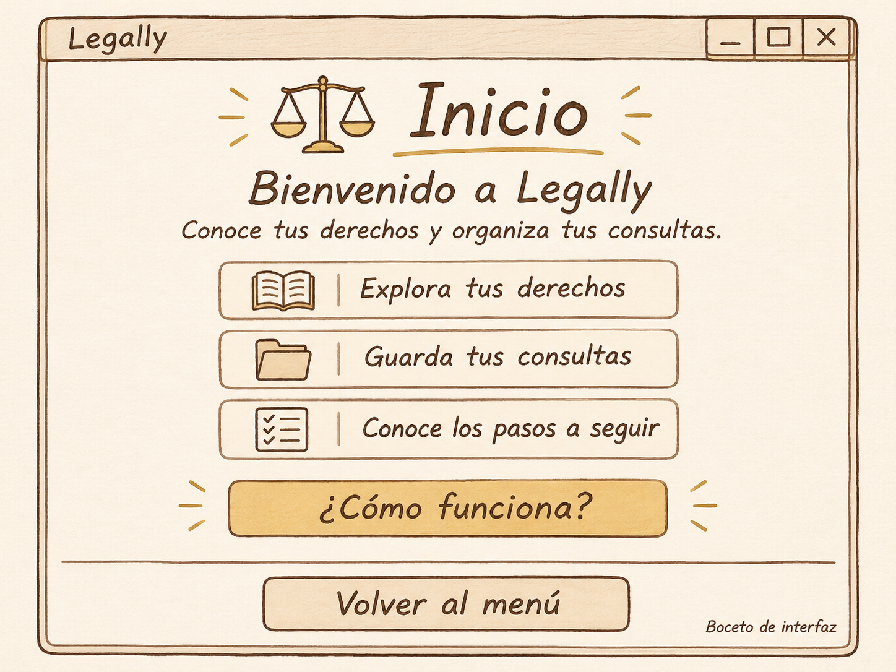

# Página de inicio

**Proyecto** Legally

**Integrante** Emiliano Gonzalez

**Fecha** 12 de noviembre de 2026

## Boceto de la pantalla

## Cambios planeados

Actualmente, en la línea 11 aparece “Proyecto Integrador - MVP”. Yo quiero cambiarlo por “Legally - Página de inicio”, para que desde la parte superior se identifique el nombre de nuestra aplicación.

Además, en la línea 12 se establece un tamaño de 420 por 340. Quiero ampliar la ventana para que quepan todos los elementos de la página de Inicio y tengan suficiente espacio entre ellos.

Después, en las líneas 14 y 15 se organiza el contenedor. Quiero ajustar sus márgenes y colocar un fondo marfil, para que la pantalla tenga los colores que estamos utilizando en Legally.

En la línea 17 aparece “Aplicación Demo (tkinter)”. Yo quiero cambiarlo por “Inicio”, con una letra más grande y de color café. También quiero agregar una balanza a un lado y una línea dorada debajo, como aparece en el boceto.

Debajo del título necesito agregar “Bienvenido a Legally” y después la frase “Conoce tus derechos y organiza tus consultas.” Quiero que ambos textos estén centrados y que el mensaje de bienvenida tenga un tamaño mayor.

Por otro lado, en las líneas 18 a 22 aparecen los cinco botones del programa base. Quiero reorganizar esa parte para mostrar “Explora tus derechos”, “Guarda tus consultas” y “Conoce los pasos a seguir”. También quiero colocar un libro, una carpeta y una lista junto a sus textos, por lo que necesito guardar esas imágenes en el proyecto y cargarlas en la pantalla.

Después de esas opciones quiero agregar el botón “¿Cómo funciona?”, con un fondo dorado. Al presionarlo, quiero que aparezca un mensaje breve explicando cómo utilizar Legally.

Asimismo, necesito ajustar los estilos de los textos y botones para utilizar colores café, marfil y dorado. Quiero que las tres opciones tengan el mismo ancho, que los bordes sean de color café y que la separación entre los elementos sea uniforme.

Finalmente, en la línea 23 quiero adaptar la línea divisoria y darle más espacio alrededor. En la línea 24 aparece “Salir”, pero yo quiero cambiarlo por “Volver al menú” y ajustar su acción para regresar al menú principal.

## Reflexión

Considero que estos cambios apoyan la idea de Legally, ya que una pantalla de inicio clara ayudará a que el usuario entienda para qué sirve la aplicación y encuentre las opciones con facilidad. También quiero que los colores y los íconos tengan relación con el proyecto, porque eso permitirá reconocer mejor cada función desde el primer momento.
