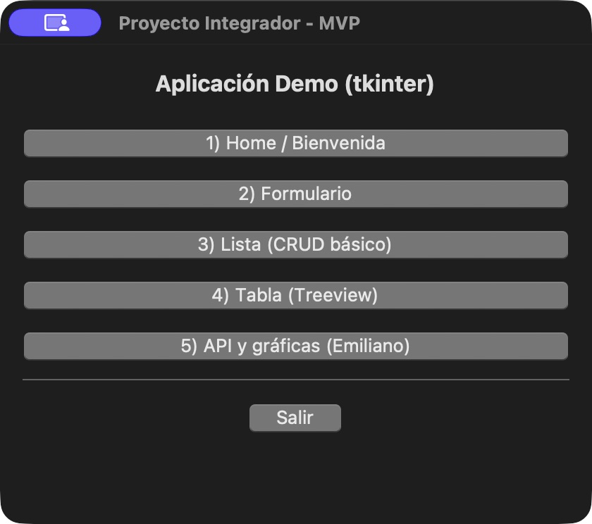
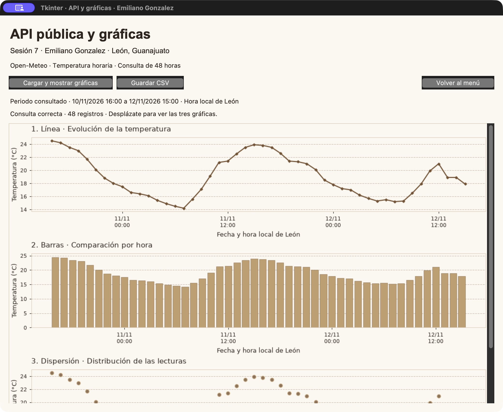
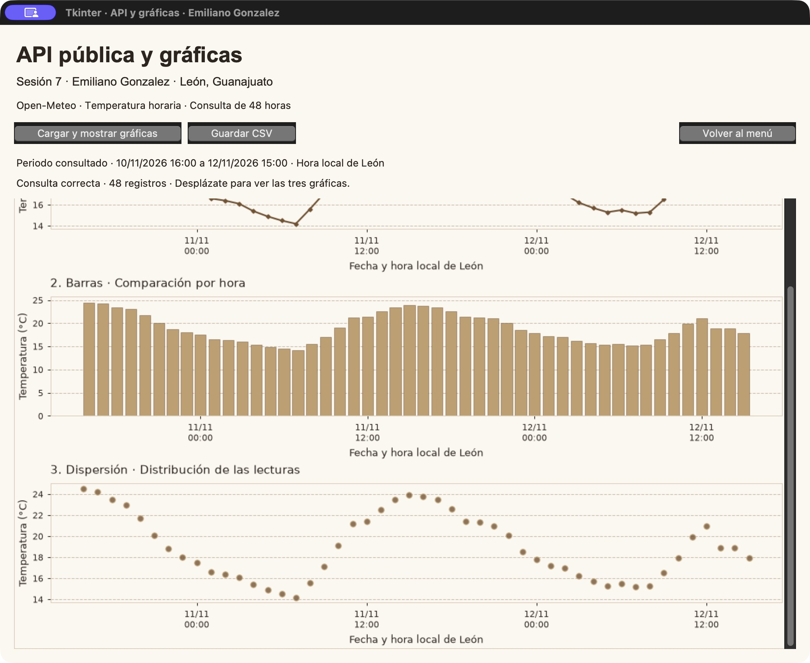
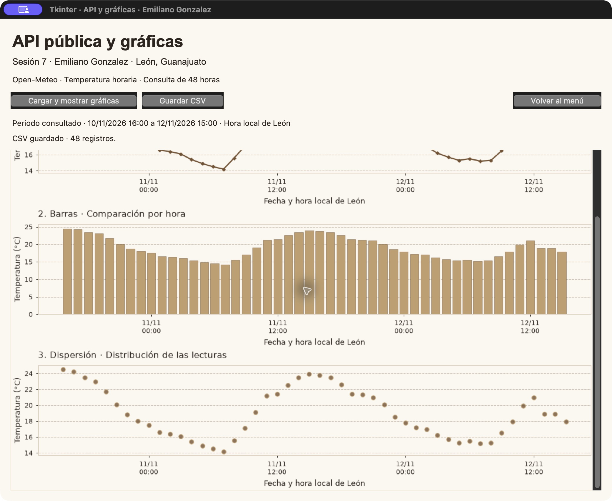

# Página de inicio

**Proyecto** Legally

**Integrante** Emiliano Gonzalez

**Fecha** 12 de noviembre de 2026

## Boceto de la pantalla


## Cambios planeados

Actualmente, en la línea 11 aparece “Proyecto Integrador - MVP”. Yo quiero cambiarlo por “Legally - Página de inicio”, para que desde la parte superior se identifique el nombre de nuestra aplicación.

Además, en la línea 12 se establece un tamaño de 420 por 340. Quiero ampliar la ventana para que quepan todos los elementos de la página de Inicio y tengan suficiente espacio entre ellos.

Después, en las líneas 14 y 15 se organiza el contenedor. Quiero ajustar sus márgenes y colocar un fondo marfil, para que la pantalla tenga los colores que estamos utilizando en Legally.

En la línea 17 aparece “Aplicación Demo (tkinter)”. Yo quiero cambiarlo por “Inicio”, con una letra más grande y de color café. También quiero agregar una balanza a un lado y una línea dorada debajo, como aparece en el boceto.

Debajo del título necesito agregar “Bienvenido a Legally” y después la frase “Conoce tus derechos y organiza tus consultas.” Quiero que ambos textos estén centrados y que el mensaje de bienvenida tenga un tamaño mayor.

Por otro lado, en las líneas 18 a 22 aparecen los cinco botones del programa base. Quiero reorganizar esa parte para mostrar “Explora tus derechos”, “Guarda tus consultas” y “Conoce los pasos a seguir”. También quiero colocar un libro, una carpeta y una lista junto a sus textos, por lo que necesito guardar esas imágenes en el proyecto y cargarlas en la pantalla.

Después de esas opciones quiero agregar el botón “¿Cómo funciona?”, con un fondo dorado. Al presionarlo, quiero que aparezca un mensaje breve explicando cómo utilizar Legally.

Asimismo, necesito ajustar los estilos de los textos y botones para utilizar colores café, marfil y dorado. Quiero que las tres opciones tengan el mismo ancho, que los bordes sean de color café y que la separación entre los elementos sea uniforme.

Finalmente, en la línea 23 quiero adaptar la línea divisoria y darle más espacio alrededor. En la línea 24 aparece “Salir”, pero yo quiero cambiarlo por “Volver al menú” y ajustar su acción para regresar al menú principal.

## Reflexión

Considero que estos cambios apoyan la idea de Legally, ya que una pantalla de inicio clara ayudará a que el usuario entienda para qué sirve la aplicación y encuentre las opciones con facilidad. También quiero que los colores y los íconos tengan relación con el proyecto, porque eso permitirá reconocer mejor cada función desde el primer momento.

---

## Sesión 7 · API pública, persistencia y gráficas

**Integrante:** Emiliano Gonzalez

**Archivo trabajado:** [`src/app/win_canvas.py`](../src/app/win_canvas.py)

**Fecha:** 12 de noviembre de 2026

En esta sesión agregué una consulta de temperatura a la quinta ventana del proyecto escolar de Tkinter. Ahora, al presionar **Cargar y mostrar gráficas**, el programa obtiene datos de Open-Meteo y los presenta en tres gráficas dentro de la misma ventana. También agregué **Guardar CSV**, para conservar la consulta en un archivo.

### Mi versión

Mi consulta utiliza las últimas **48 horas disponibles de temperatura de León, Guanajuato**, con las coordenadas 21.12 y −101.68. Elegí este rango para comparar dos días y darle una variante propia al ejercicio. Además, utilicé fondo marfil, líneas café y barras doradas, con marcadores distintos para identificar cada gráfica.

Los parámetros principales son `hourly=temperature_2m`, `past_hours=48`, `forecast_hours=0`, `temperature_unit=celsius` y `timezone=America/Mexico_City`. Las fechas se muestran con la hora local de León. Los datos provienen de la API de Open-Meteo; no son mediciones hechas por nosotros ([Open-Meteo, s. f.](https://open-meteo.com/en/docs)).

### Cambios realizados

- Cambié los dibujos de ejemplo por una consulta HTTP con `requests` y lectura de la respuesta JSON.
- Agregué validación de la respuesta HTTP, las fechas y las temperaturas. Si la consulta falla o tarda más de 15 segundos, aparece un aviso y se puede volver a intentar.
- La consulta se realiza directamente al presionar el botón, con una función y un bloque `try` / `except`. Mientras responde la API, la ventana puede hacer una pausa; la petición tiene un tiempo de espera de 15 segundos.
- Incrusté las tres gráficas con `FigureCanvasTkAgg`, siguiendo el método de integración de [Matplotlib (s. f.)](https://matplotlib.org/stable/gallery/user_interfaces/embedding_in_tk_sgskip.html): **línea**, para ver la evolución; **barras**, para comparar las horas; y **dispersión**, para mostrar cada dato por separado. Todas tienen título, fecha y hora, temperatura en °C y cuadrícula.
- Coloqué las gráficas una debajo de otra y agregué una barra de desplazamiento para verlas completas. También se puede avanzar con Av Pág y regresar con Re Pág (en Mac, Fn + flecha abajo o arriba).
- Agregué el periodo consultado y la cantidad de registros. Al recargar, las gráficas anteriores se reemplazan.
- Agregué **Guardar CSV** y **Volver al menú**. El CSV incluye las columnas `fecha_hora` y `temperatura_c`, y el usuario puede elegir dónde guardarlo.
- Actualicé el nombre del quinto botón del menú a **5) API y gráficas (Emiliano)** y agregué las dependencias en [`requirements.txt`](../requirements.txt).

### Organización del código simplificado

El archivo mantiene la estructura del programa base: importar las librerías, crear la subventana con `tk.Toplevel`, colocar los elementos y conectar cada botón con una función. Lo organicé en cuatro partes:

1. `fetch_data`: pedir los datos a la API y leer las fechas y temperaturas.
2. `guardar_csv`: abrir un archivo y escribir los datos con un ciclo `for`.
3. `crear_graficas`: dibujar la línea, las barras y la dispersión.
4. `open_win_canvas`: crear la ventana y sus botones **Cargar**, **Guardar CSV** y **Volver al menú**.

También simplifiqué la recarga: se limpia la misma figura y se dibujan los datos nuevos. Conservé los colores y la distribución de la pantalla. La apariencia requiere varias líneas para los títulos, los ejes, los botones y el desplazamiento, pero ahora la consulta y el guardado utilizan funciones, listas y ciclos básicos.

### Cómo ejecutar y revisar mi ventana

1. Abrir la carpeta del proyecto en VS Code y seleccionar el intérprete de `.venv`.
2. Instalar las dependencias desde la terminal del proyecto:

   ```bash
   python -m pip install -r requirements.txt
   ```

3. En **Run and Debug**, elegir **Ejecutar main (src.app.main)** y presionar **F5**. Desde una terminal con `.venv` activo también se puede ejecutar:

   ```bash
   python -m src.app.main
   ```

4. Entrar en **5) API y gráficas (Emiliano)** y presionar **Cargar y mostrar gráficas**. Esta consulta necesita conexión a internet.
5. Desplazarse hacia abajo para revisar las tres gráficas. Después, presionar **Guardar CSV** si se quiere conservar la consulta, o **Volver al menú** para regresar.

En macOS, si el entorno todavía no está activo, se activa con `source .venv/bin/activate`. En una copia nueva del repositorio primero se crea con `python3 -m venv .venv`. En Windows se crea con `python -m venv .venv` y se activa en PowerShell con `.venv\Scripts\Activate.ps1`.

### Persistencia y datos de ejemplo

En [`data/temperaturas_emiliano.csv`](../data/temperaturas_emiliano.csv) dejé una consulta de ejemplo con **48 registros**, del **10/11/2026 a las 16:00** al **12/11/2026 a las 15:00**, con la hora local de León. El archivo se puede abrir sin conexión. Al volver a consultar la API, el periodo puede cambiar; el CSV se actualiza únicamente cuando se guarda una nueva consulta.

### Capturas de la aplicación en ejecución

**Acceso desde el menú principal:**



**Consulta de 48 registros y gráfica de línea:**



**Gráficas de barras y dispersión al desplazar la ventana:**



**Confirmación del guardado en CSV:**



### Comprobación

Se comprobó la consulta real de 48 registros, el renderizado de las tres gráficas, el acceso desde el menú, el desplazamiento con teclado, el regreso al menú y el guardado desde el cuadro de diálogo. También se probaron respuestas vacías o inválidas, errores HTTP y tiempo de espera. La comprobación de dependencias con `pip check` terminó sin conflictos.

### Reflexión de la sesión 7

Considero que esta actividad ayuda a entender cómo una aplicación puede obtener información de una fuente externa y mostrarla de una forma más clara, ya que los mismos datos se pueden comparar con distintas gráficas. También es útil guardarlos en un CSV, porque así podemos revisar una consulta después. En el caso de nuestro proyecto, este ejercicio sirve para practicar la conexión con una API antes de integrar información relacionada con Legally.

### Referencias

Matplotlib. (s. f.). *Embed in Tk*. https://matplotlib.org/stable/gallery/user_interfaces/embedding_in_tk_sgskip.html

Open-Meteo. (s. f.). *Weather Forecast API*. https://open-meteo.com/en/docs
