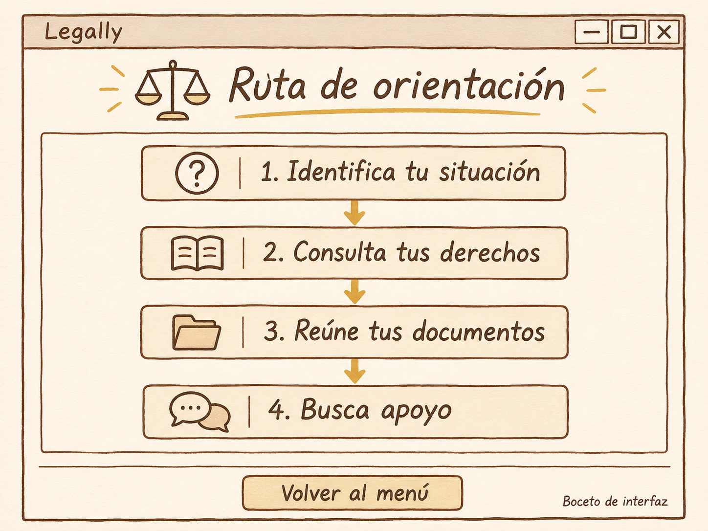

# Ruta de orientación

**Proyecto** Legally

**Integrante** Fabio Andrade

**Fecha** 12 de noviembre de 2026

## Boceto de la pantalla

## Cambios planeados

Quiero cambiar el título de la ventana por “Legally - Ruta de orientación”, para que se identifique el nombre de la aplicación y la sección que estoy utilizando.

Además, necesito ampliar el tamaño de la ventana y ajustar los márgenes, ya que quiero acomodar los cuatro pasos de manera vertical y dejar suficiente espacio entre ellos.

Después, quiero colocar un fondo marfil y agregar el encabezado “Ruta de orientación”, con una letra grande de color café. También necesito colocar una balanza a un lado y una línea dorada debajo, como aparece en el boceto.

Dentro del área de dibujo de `Canvas`, quiero reemplazar las figuras de ejemplo por cuatro recuadros con bordes café y un fondo beige claro. En cada uno quiero colocar estos textos, siguiendo el orden de la imagen.

1. Identifica tu situación
2. Consulta tus derechos
3. Reúne tus documentos
4. Busca apoyo

Asimismo, quiero agregar un signo de interrogación, un libro, una carpeta y unos globos de conversación junto a los pasos correspondientes. Para eso necesito preparar las imágenes y cargarlas dentro del área de dibujo.

También quiero colocar una flecha dorada entre cada recuadro, apuntando hacia abajo, para que se entienda el orden de los pasos. Los recuadros deben tener el mismo tamaño y quedar alineados.

Finalmente, quiero agregar una línea divisoria debajo del área de dibujo y cambiar el botón “Cerrar” por “Volver al menú”. Al presionarlo, se cerraría esta subventana para regresar al menú principal.
