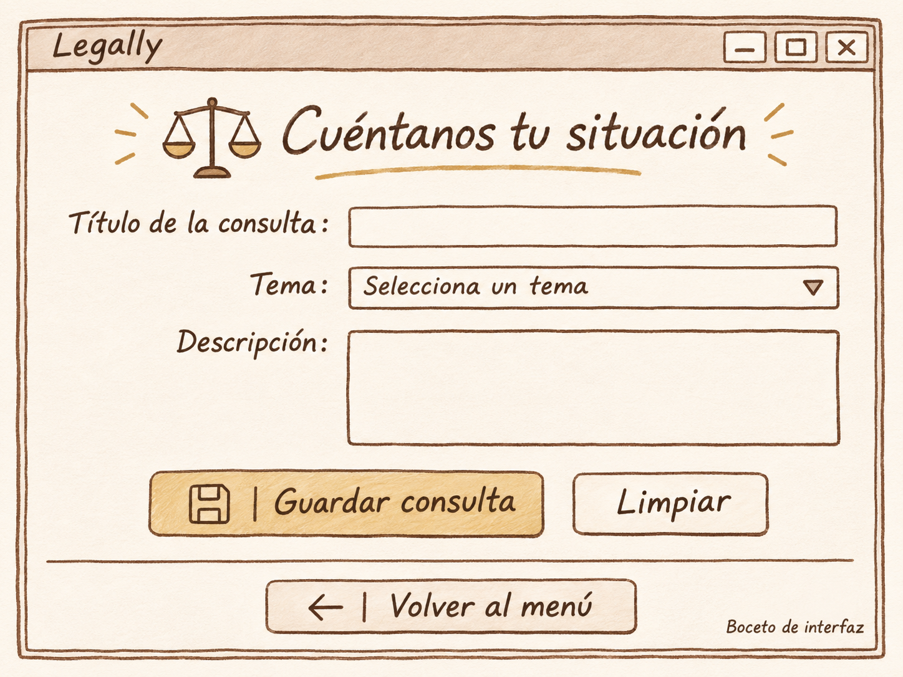

# Cuéntanos tu situación

**Proyecto** Legally

**Integrante** Germán Ahgue

**Fecha** 12 de noviembre de 2026

## Boceto de la pantalla

## Cambios planeados

En la línea 6 se establece el título de la ventana como “Home / Bienvenida”. Yo quiero cambiarlo por “Legally - Cuéntanos tu situación”, para que desde la parte superior se identifique el nombre de nuestra aplicación y la sección en la que se encuentra el usuario.

En la línea 7 se establece un tamaño de 360 por 220. Quiero ampliar las dimensiones de la ventana para que se puedan visualizar correctamente todos los elementos del formulario, siguiendo las proporciones del boceto que adjunté.

Después, en las líneas 8 y 9 se crea y organiza el contenedor principal. Quiero modificar sus márgenes y personalizar su fondo con un color marfil, utilizando también tonos café y dorados para los bordes y los detalles decorativos, de manera que la pantalla mantenga igual los colores que usamos en Legally.

En la línea 11 aparece el texto “¡Bienvenid@s!”. Yo quiero sustituirlo por el encabezado “Cuéntanos tu situación”, utilizando una tipografía más grande, color café oscuro. También quiero agregar un icono de una balanza legal a un lado del título y una línea decorativa dorada debajo.

Por otro lado, en la línea 12 aparece el texto “Explora las ventanas desde la pantalla principal”. Quiero sustituirlo por los campos que permitirán al usuario registrar su consulta legal.

Primero, quiero agregar el apartado “Título de la consulta”, acompañado de un campo de texto en el que el usuario pueda escribir un título para identificar su situación.

Debajo quiero agregar el apartado “Tema”, utilizando un menú desplegable (`Combobox`) que permita seleccionar la categoría legal a la que pertenece su consulta. Entre las opciones quiero incluir Derecho familiar, Derecho laboral, Derecho civil, Derecho penal, Derecho mercantil y Otros.

Después necesito agregar el apartado “Descripción”, acompañado de un cuadro de texto de mayor tamaño que permita al usuario explicar detalladamente su situación y proporcionar la información necesaria sobre su consulta.

### Botones y distribución

En cuanto a los botones, actualmente en las líneas 13 y 14 aparecen las opciones “Mostrar mensaje” y “Cerrar”. Quiero sustituirlos por tres botones diferentes.

El primero será “Guardar consulta”, acompañado de un icono de guarda. Su función será recuperar la información introducida en los campos de título, tema y descripción para guardar la consulta del usuario.

El segundo será “Limpiar”, cuya función será borrar el contenido de todos los campos del formulario para que el usuario pueda comenzar a registrar una nueva consulta.

Finalmente, quiero agregar el botón “Volver al menú”, acompañado de una flecha hacia la izquierda. Al presionarlo, quiero que se cierre la ventana actual y que el usuario regrese a la pantalla del menú principal.

Asimismo, necesito reorganizar la distribución de todos los elementos. Actualmente se utiliza `.pack()` para acomodarlos verticalmente, pero quiero utilizar principalmente `.grid()` para organizar las etiquetas, los campos de texto y los botones en filas y columnas, de manera que la distribución sea similar a la del boceto.

Finalmente, quiero agregar una línea divisoria debajo de los botones principales, con suficiente espacio alrededor para separar visualmente el formulario de la opción “Volver al menú”.

## Reflexión

Pienso que adaptar el formulario ayudará a que las personas organicen su situación y expliquen qué necesitan consultar. Al separar el título, el tema y la descripción, la información quedará más clara. Esto va de la mano con Legally, porque buscamos que consultar información sobre sus derechos sea más sencillo desde el inicio.
