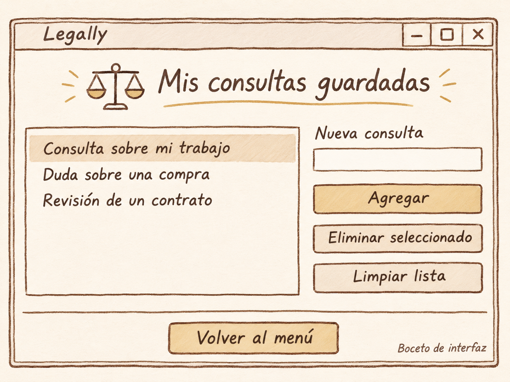

# Mis consultas guardadas

**Proyecto** Legally

**Integrante** Marcelo Anaya

**Fecha** 12 de noviembre de 2026

## Boceto de la pantalla

## Cambios planeados

Actualmente, en la línea 6 la ventana tiene el título "Lista (CRUD básico)", pero quiero cambiarlo por "Legally - Mis consultas guardadas" y ampliar el tamaño de la línea 7 para que todos los elementos quepan cómodos y tengan buen espacio. En las líneas 9 y 10 voy a ajustar los márgenes del contenedor y aplicar nuestro fondo color beige tanto en él como en la ventana principal.

Arriba de los controles actuales necesito agregar el encabezado con el ícono de la balanza y el título "Mis consultas guardadas" en letra grande color café, subrayado con una línea dorada como en el boceto. Esto hará que tenga que recorrer una fila hacia abajo los elementos que ya están en la cuadrícula.

De las líneas 12 a la 15 voy a dejar el `Listbox` en la columna izquierda, pero personalizándolo con fondo beige, borde y texto en café, y un resaltado dorado suave al seleccionar una consulta. A la derecha, justo encima del campo de texto de las líneas 17 y 18, agregaré la etiqueta "Nueva consulta" en color café.

Las funciones `agregar()`, `eliminar()` y `limpiar()` se quedan igual en su lógica, cambiando solo el mensaje de aviso de la línea 26 a "Escribe una consulta para agregar.". En los botones de la derecha cambiaré "Limpiar" por "Limpiar lista" y les daré a los tres el mismo ancho, bordes café y una separación uniforme: "Agregar" llevará fondo dorado para destacar, mientras que los otros dos irán en beige.

Por último, antes de la línea 40 pondré una línea divisoria horizontal con suficiente espacio alrededor. En la línea 40 cambiaré el botón "Cerrar" por "Volver al menú", centrándolo abajo en lugar de alinearlo a la derecha con fondo dorado y la acción configurada para regresar al menú principal.
