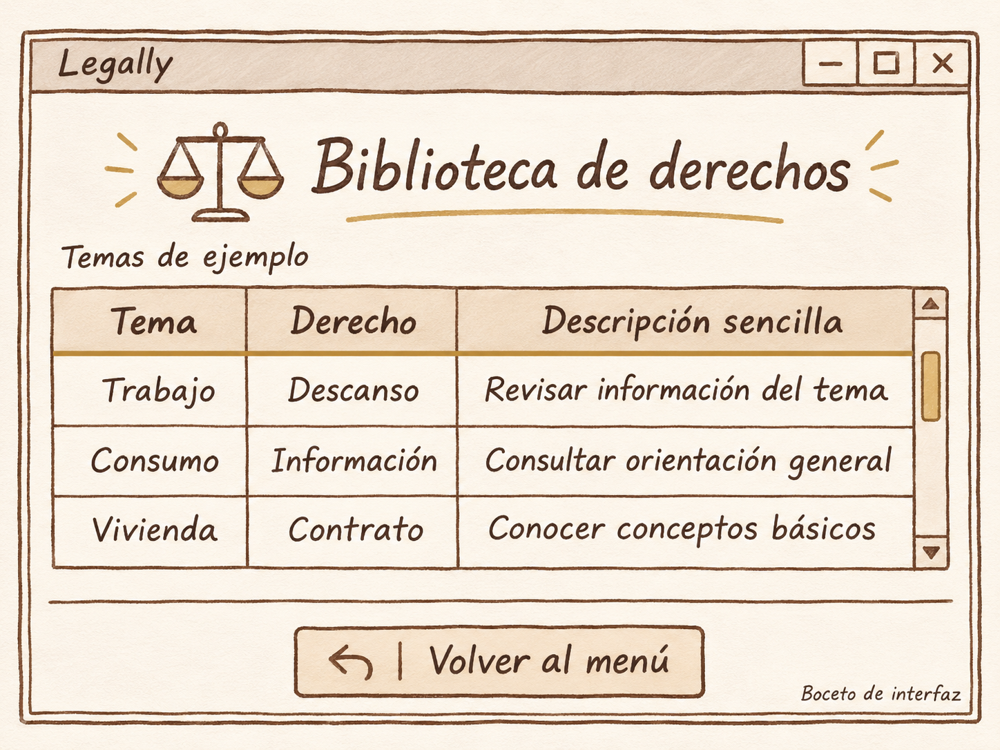

# Biblioteca de derechos

**Proyecto** Legally

**Integrante** Miguel Gonzalez

**Fecha** 12 de noviembre de 2026

## Boceto de la pantalla

## Cambios planeados

Para lograr la ventana de la Biblioteca de derechos, quiero realizar los siguientes cambios en el código.

Primero, quiero modificar el título superior de la ventana para identificar correctamente el nombre de la aplicación y la sección actual, además de ampliar sus dimensiones y ajustar los márgenes para acomodar todos los elementos con un fondo de color marfil o beige.

En la parte superior del contenido principal, quiero agregar el encabezado con el icono de la balanza y el título "Biblioteca de derechos" en letra grande de color café, subrayado con una línea dorada como se muestra en el boceto. Justo debajo, quiero incorporar el subtítulo correspondiente a los "Temas de ejemplo".

En la sección central, quiero configurar las columnas de la tabla para mostrar los campos de Tema, Derecho y Descripción sencilla. Asimismo, quiero insertar las filas de contenido correspondientes a los casos de muestra: Trabajo con su respectivo Descanso, Consumo con Información, y Vivienda con Contrato, acompañados de sus descripciones. A un costado, quiero habilitar la barra de desplazamiento vertical con sus elementos de control.

Finalmente, antes de la sección inferior, quiero añadir una línea divisoria horizontal y cambiar el botón de salida por "Volver al menú", integrando un icono de flecha hacia la izquierda y configurando su acción para regresar a la pantalla principal.

## Reflexión

Considero que la biblioteca de derechos será una parte importante de Legally, ya que permitirá presentar la información por temas y con descripciones sencillas. Organizarla en una tabla ayudará a encontrar lo que se quiere consultar con mayor facilidad. Por eso, quiero que los títulos sean claros y que el contenido se pueda leer cómodamente.
