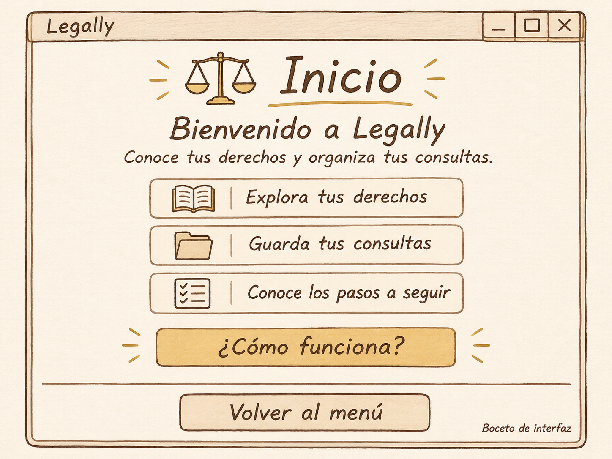
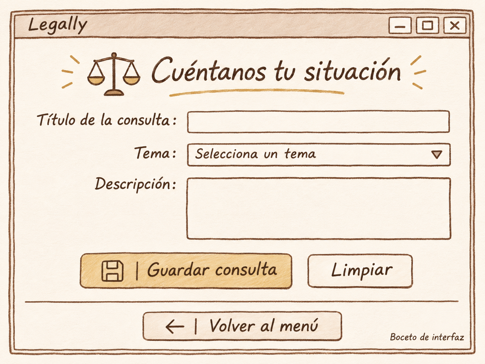
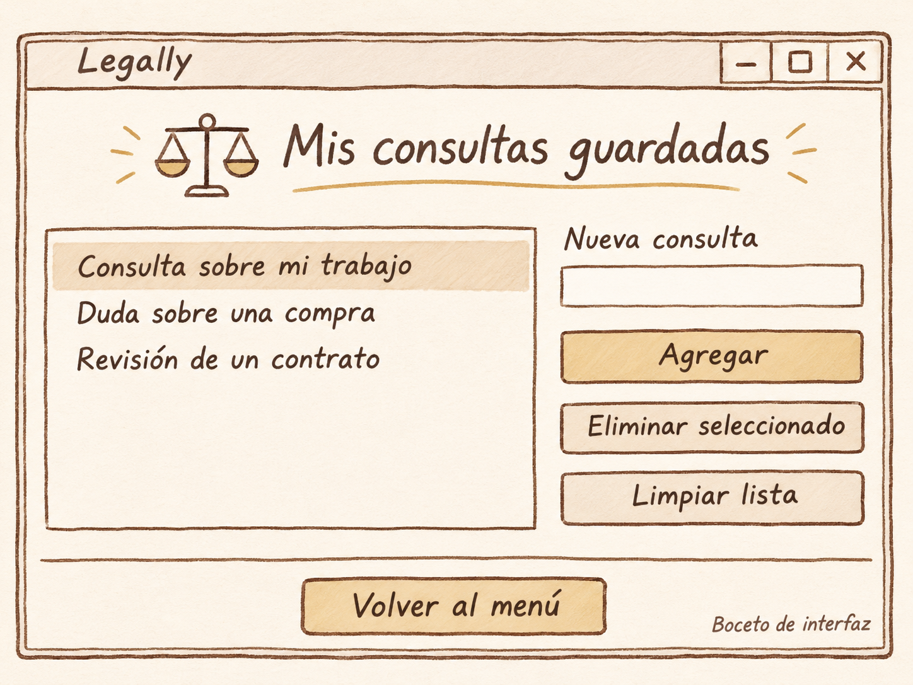
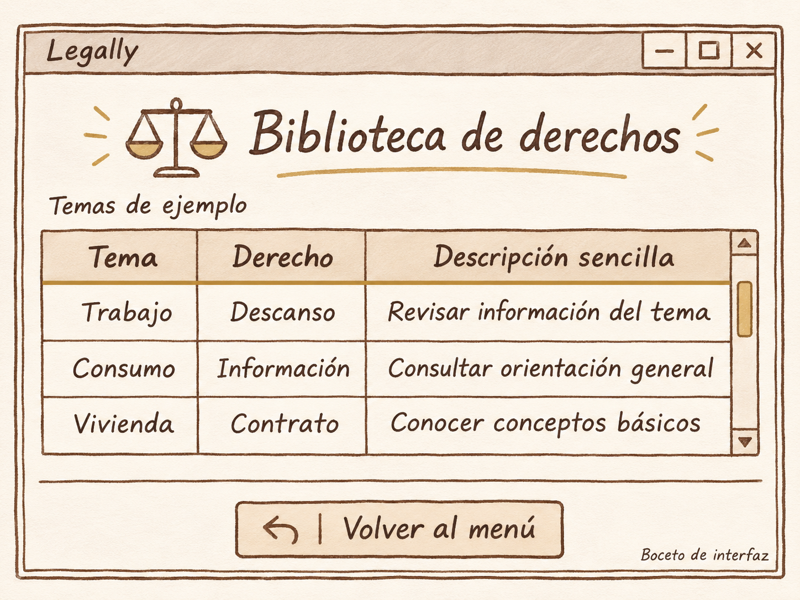
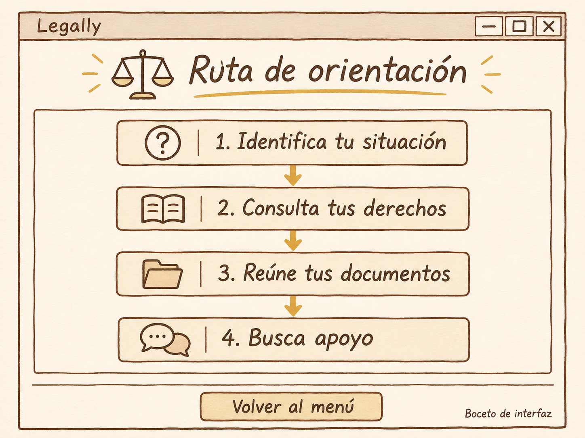

# Legally · Bocetos de las cinco pantallas

La propuesta utiliza marfil en los fondos, café en los textos y bordes, y dorado en los detalles.

## 1. Página de inicio

**Bienvenido a Legally**

Conoce tus derechos y organiza tus consultas.

- Explora tus derechos.
- Guarda tus consultas.
- Conoce los pasos a seguir.
- ¿Cómo funciona?
- Volver al menú.

[Ver cambios planeados](05_adaptacion_ventana_emiliano.md).

## 2. Cuéntanos tu situación

**Campos del formulario**

- Título de la consulta.
- Tema. Selecciona un tema.
- Descripción.

**Botones**

- Guardar consulta.
- Limpiar.
- Volver al menú.

[Ver cambios planeados](05_adaptacion_ventana_german.md).

## 3. Mis consultas guardadas

**Consultas de ejemplo**

- Consulta sobre mi trabajo.
- Duda sobre una compra.
- Revisión de un contrato.

**Campo** Nueva consulta.

**Botones**

- Agregar.
- Eliminar seleccionado.
- Limpiar lista.
- Volver al menú.

[Ver cambios planeados](05_adaptacion_ventana_marcelo.md).

## 4. Biblioteca de derechos

**Temas de ejemplo**

| Tema | Derecho | Descripción sencilla |
| --- | --- | --- |
| Trabajo | Descanso | Revisar información del tema |
| Consumo | Información | Consultar orientación general |
| Vivienda | Contrato | Conocer conceptos básicos |

**Botón** Volver al menú.

[Ver cambios planeados](05_adaptacion_ventana_miguel.md).

## 5. Ruta de orientación

1. Identifica tu situación.
2. Consulta tus derechos.
3. Reúne tus documentos.
4. Busca apoyo.

**Botón** Volver al menú.

[Ver cambios planeados](05_adaptacion_ventana_fabio.md).
