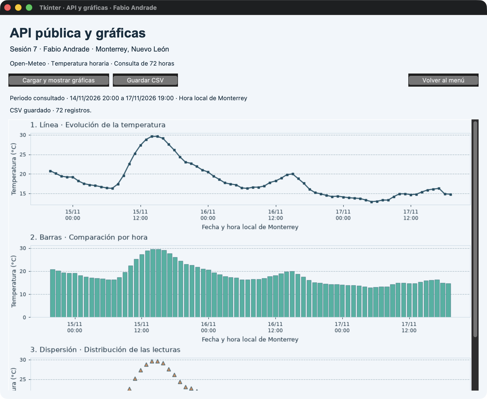
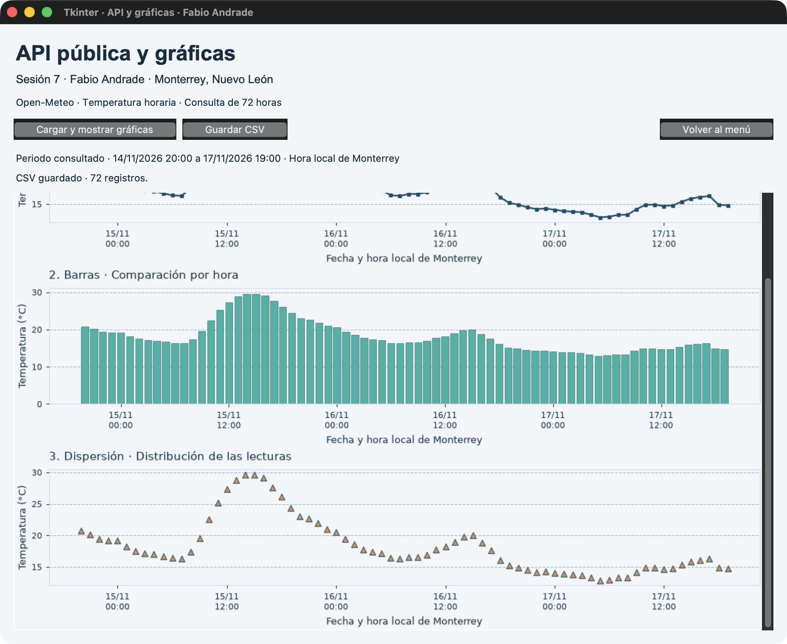

# Sesión 7 — API pública, persistencia y gráficas

**Entrega individual: Fabio Andrade**  
**Repositorio del equipo:** emigonzalez8/sesion-3-tkinter

## Objetivo y archivos

Esta versión consulta temperaturas horarias de Monterrey en Open-Meteo, las muestra en tres gráficas de Matplotlib dentro de tkinter y permite guardar la consulta en CSV. Se parte del proyecto del equipo y se conserva su estructura modular.

La implementación individual está en `src/app/win_canvas_fabio.py`, equivalente a la ventana `win_canvas.py` solicitada. Tiene un archivo propio para conservar la entrega existente de Emiliano. En `src/app/main.py` se agregó el botón **6) API y gráficas (Fabio Andrade)** y se amplió el menú para mostrarlo completo.

## Cambios individuales

- Ciudad: Monterrey, Nuevo León; latitud `25.6866`, longitud `-100.3161`.
- Rango: las últimas **72 horas**, con `past_hours=72` y `forecast_hours=0`; la versión existente de Emiliano usa 48 horas de León.
- Variable: `hourly=temperature_2m`, en grados Celsius; zona horaria `America/Mexico_City`.
- Diseño: fondo azul claro, títulos azul oscuro, barras turquesa y puntos naranjas. El nombre de Fabio aparece en la ventana y en el encabezado.
- Línea con marcadores cuadrados, barras por hora y dispersión con triángulos. Cada gráfica tiene título, ejes con unidades, fechas legibles y rejilla horizontal.
- Las tres gráficas se colocan una debajo de otra en un área desplazable. Dos capturas permiten verlas completas.
- Persistencia: botón **Guardar CSV**, con nombre sugerido `temperaturas_fabio.csv` y columnas `fecha_hora,temperatura_c`.

## Explicación del código

`fetch_data()` realiza una petición GET a `https://api.open-meteo.com/v1/forecast` con un tiempo máximo de espera de 15 segundos. Verifica el estado HTTP con `raise_for_status()`, convierte el JSON en listas de fechas y temperaturas, y comprueba que tengan datos y longitudes iguales. Convierte las temperaturas a números y valida las fechas.

`crear_graficas()` convierte las fechas ISO en objetos `datetime` y crea tres ejes: `plot()` para evolución, `bar()` para comparación y `scatter()` para distribución. Limpia la figura antes de volver a dibujar, evitando acumular gráficas al recargar. El localizador automático de fechas limita la cantidad de etiquetas.

`open_win_canvas()` crea un `Toplevel` conectado al menú. Su botón de carga consulta la API y dibuja la figura mediante `FigureCanvasTkAgg`. El encabezado muestra el periodo recibido y la cantidad de registros. Los errores de conexión o de datos aparecen en un `messagebox`; se puede volver a intentar.

`guardar_csv()` escribe las fechas y temperaturas en UTF-8. El botón de guardado se habilita después de una consulta correcta y utiliza un diálogo para elegir la ubicación. Si ocurre un error de escritura, se informa al usuario. El CSV adjunto es una evidencia de la consulta realizada, no una sustitución de la API.

## Instalación y ejecución en macOS

Desde la raíz del repositorio:

```bash
python3 -m venv .venv
source .venv/bin/activate
python -m pip install -r requirements.txt
python -m pip show requests matplotlib
python -m pip check
python -m src.app.main
```

Seleccionar **6) API y gráficas (Fabio Andrade)** y pulsar **Cargar y mostrar gráficas**. Desplazarse hacia abajo para ver la dispersión y pulsar **Guardar CSV** para conservar los datos. **Volver al menú** cierra únicamente esta subventana.

En macOS se utiliza `pip show` para verificar versiones; el `findstr` de la guía corresponde a Windows. Se requiere Python con tkinter y conexión a Internet.

## Prueba realizada

- Bibliotecas instaladas en `.venv`: requests **2.34.2** y Matplotlib **3.11.2**.
- `pip check`: sin dependencias incompatibles.
- Apertura desde el botón del menú principal y consulta real a Open-Meteo: correctas.
- Se obtuvieron **72 registros**, del **14/11/2026 20:00** al **17/11/2026 19:00**, hora local.
- Se dibujaron línea, barras y dispersión y se comprobó su presentación en las capturas.
- Se probó el guardado desde el botón y se verificaron 72 filas en [el CSV de Fabio](../data/temperaturas_fabio.csv).

El periodo y los valores cambian al volver a consultar la API.

## Evidencia de la aplicación ejecutada

### Parte superior: identificación, periodo y línea



### Parte inferior: barras y dispersión



## Referencias

- Código base de tkinter del equipo y guía de la Sesión 7.
- [Documentación oficial de Open-Meteo](https://open-meteo.com/en/docs): parámetros de consulta horaria, ubicación y zona horaria.
